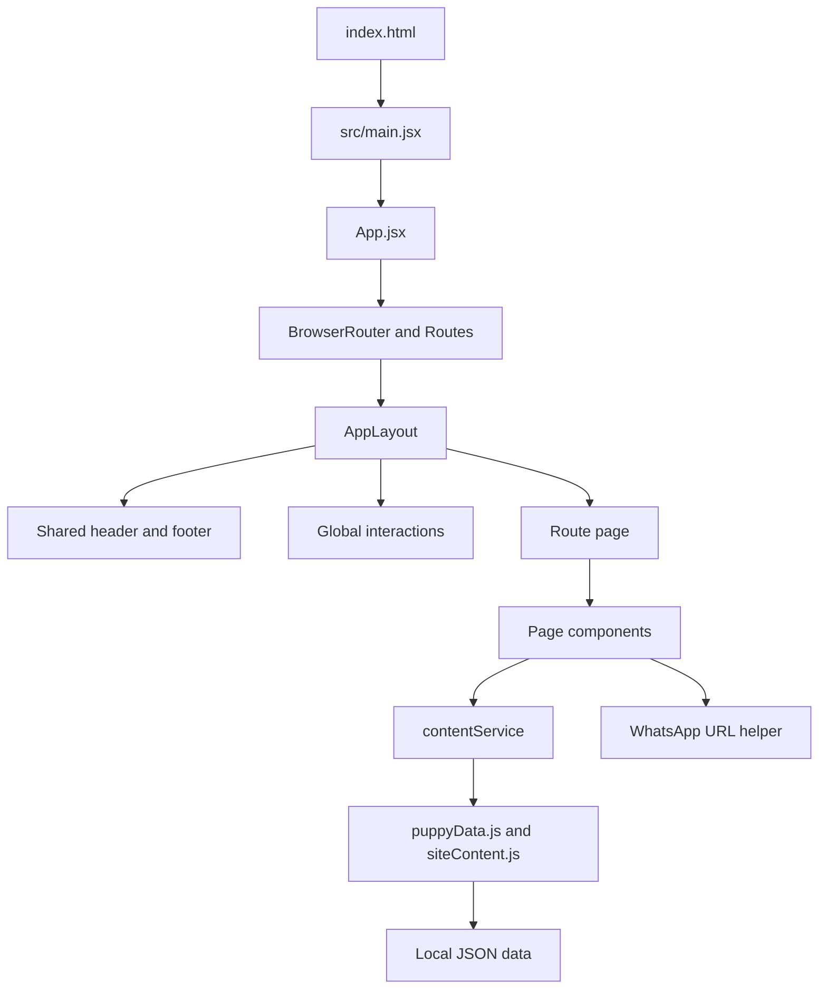

# TeddyPups — Puppy Website

[](https://github.com/dikshaforsure/P-mart/actions/workflows/phase2-tests.yml)

A responsive, multi-page React frontend for the TeddyPups puppy website. The application brings together a story-led homepage, an available-puppy catalogue, individual puppy profiles, a previously-homed archive, a family photo gallery and customer information pages.

The project is built with JavaScript and JSX. Its content is currently served from local JSON and JavaScript data modules, while enquiry actions prepare messages for the customer to review and send through WhatsApp.

> **Current scope:** the public-facing frontend is implemented. A backend API, database persistence, administrator interface and production deployment are not part of the current application.

## Contents

- [Features](#features)
- [Routes](#routes)
- [Technology stack](#technology-stack)
- [Application architecture](#application-architecture)
- [Content and data](#content-and-data)
- [Getting started](#getting-started)
- [Available scripts](#available-scripts)
- [Environment configuration](#environment-configuration)
- [Testing and continuous integration](#testing-and-continuous-integration)
- [Accessibility, motion and performance](#accessibility-motion-and-performance)
- [Project structure](#project-structure)
- [Current limitations and next steps](#current-limitations-and-next-steps)
- [Project documentation](#project-documentation)
- [License](#license)

---

## Features

### Website pages

- **Homepage:** brand introduction, featured puppies, showroom/import options, the puppy journey, trust highlights, family moments, FAQ preview and enquiry calls to action.
- **Available-puppy catalogue:** data-driven cards with filters for origin, breed, gender and collection. Filter state is represented in the URL, so a filtered view can be refreshed or shared.
- **Puppy profiles:** one reusable route renders both available and previously homed puppies from their exact data slugs. Each profile includes puppy details, media, care information, journey content where applicable, adjacent-puppy navigation and enquiry actions.
- **Gone Home:** an archive of puppies whose records have a sold status.
- **Happy Families:** a family-and-puppy image gallery with an image viewer, previous/next navigation and optional captions.
- **How It Works:** separate local and imported puppy journeys, with four steps in each path and supporting information.
- **FAQ:** searchable questions and answers, a live result count, an empty state and expandable answers.
- **Contact:** contact information and a validated enquiry form that prepares a WhatsApp message.

### Puppy catalogue and profile behaviour

- The catalogue shows published records whose status is `available`.
- Origin, breed, gender and collection filters can be combined. A puppy must satisfy every active filter.
- Filter selections are kept in the URL query string.
- Profile lookup uses the stored `slug`; slugs are not generated from display names.
- Sold records remain addressable through their profile routes even though they do not appear in the available catalogue.
- Puppy galleries support variable-length image and video collections, thumbnails, previous/next controls, media counters, captions, native video controls and unavailable-media fallbacks.
- Profile enquiries include the selected puppy's context in the prepared WhatsApp message.

### Shared interactions

- Shared header, responsive navigation and footer.
- Scroll-to-top behaviour for pathname changes, with query-only changes treated separately.
- Decorative paw trail for supported pointer devices.
- A shared route-transition curtain with a running puppy, alternating diagonal leg pairs and a pawprint trail.
- Browser network hints adjust the route-transition runner duration when the Network Information API is available; a default duration is used when it is not.
- Reduced-motion preferences are respected by the animated interactions.

---

## Routes

| Route | Page | Purpose |
|---|---|---|
| `/` | Homepage | Brand introduction and featured content |
| `/puppies` | Available puppies | Browse and filter available puppy records |
| `/puppies/:slug` | Puppy profile | View an individual available or sold puppy |
| `/gone-home` | Gone Home | Browse previously homed puppies |
| `/happy-families` | Happy Families | View family and puppy moments |
| `/how-it-works` | How It Works | Explore local and imported journeys |
| `/faq` | FAQ | Search and expand common questions |
| `/contact` | Contact | View contact information and prepare an enquiry |
| `*` | Not Found | Handle unknown routes |

### Catalogue query parameters

The catalogue supports these URL-backed filters:

| Parameter | Filters by |
|---|---|
| `origin` | Puppy origin |
| `breed` | Breed |
| `gender` | Gender |
| `collection` | Collection |

Filters are combined using **AND** logic. Clearing the filters removes the corresponding query parameters.

---

## Technology stack

| Area | Technology |
|---|---|
| UI | React 19, React DOM |
| Language | JavaScript (ES modules) and JSX |
| Routing | React Router DOM 7 |
| Build and development server | Vite 8 |
| Styling | Tailwind CSS 4, the Tailwind Vite plugin and project CSS |
| Unit/component testing | Vitest 5 |
| Component testing utilities | React Testing Library, Testing Library DOM and jest-dom |
| Test browser environment | jsdom |
| Automation | GitHub Actions |

The repository intentionally uses JavaScript/JSX. It does not use TypeScript or TSX.

---

## Application architecture

The frontend is a single-page application. React Router selects the page, while a shared layout provides the site-wide navigation, footer and global interactions.



### Runtime flow

1. `frontend/index.html` provides the root element and loads `src/main.jsx`.
2. `main.jsx` mounts the React application.
3. `app/App.jsx` defines the public routes inside `BrowserRouter`.
4. `AppLayout.jsx` wraps the routes with the shared header, main content region, footer, scroll handling, pointer decoration and page-transition curtain.
5. Page components obtain structured content through the existing data/service modules.
6. Enquiry components validate their fields and use the shared WhatsApp helper to prepare a message.

### Data-access boundary

`src/services/contentService.js` provides Promise-based methods for site settings, featured puppies, available puppies, puppy lookup, adjacent records, breeds and homepage content.

At present, these methods resolve local data; they do **not** make HTTP requests. This keeps the page components separated from the data source and provides a boundary for a future API integration without implying that a backend already exists.

---

## Content and data

The main content is stored under `frontend/src/data/`.

| File | Responsibility |
|---|---|
| `puppies.json` | Puppy records, availability, profile fields and media metadata |
| `breeds.json` | Breed reference records |
| `pages.json` | Page and route metadata |
| `families.json` | Family gallery records |
| `home-families.json` | Homepage family-preview records |
| `faq.json` | FAQ question-and-answer records |
| `howItWorksContent.js` | Local/imported journey and supporting page content |
| `siteContent.js` | Shared website copy, settings and homepage content |
| `referenceAssets.js` | Centralised image references used by the homepage |
| `puppyData.js` | Puppy filtering, lookup, mapping and adjacent-record helpers |

### Current data snapshot

The committed data currently contains:

| Dataset | Records |
|---|---:|
| All puppies | 42 |
| Available puppies | 15 |
| Sold / previously homed puppies | 27 |
| Breeds | 8 |
| FAQs | 9 |
| Family gallery | 64 |

The counts describe the committed data snapshot. They are not a live inventory feed.

### Enquiry flow

Contact and puppy enquiry forms perform client-side validation and prepare a context-specific WhatsApp message. The browser opens WhatsApp with the message prefilled; the user must review and send it there.

The current flow does not:

- submit an enquiry to a server;
- store form data in a database;
- send a message automatically;
- provide server-side validation or spam protection.

The WhatsApp destination is centralised through `src/utils/whatsapp.js` and the site settings in `src/data/siteContent.js`.

---

## Getting started

### Prerequisites

- **Node.js:** use Node 22.12 or newer for the current Vite/Vitest toolchain. The package engine also permits Node 20.19 or newer.
- **npm:** npm 10 or newer is recommended.

Check your installed versions:

```bash
node --version
npm --version
```

### Install dependencies

Run these commands from the repository root:

```bash
cd frontend
npm install
```

### Start the development server

```bash
npm run dev
```

Vite normally serves the application at:

```
http://localhost:5173
```

The Vite configuration binds the development server to `0.0.0.0`, which also allows access from another device on the same network when the host firewall/network permits it.

### Build and preview

```bash
npm run build
npm run preview
```

The production build is written to `frontend/dist/`. The preview command serves that built output locally; it is not a deployment.

---

## Available scripts

Run scripts from the `frontend/` directory.

| Command | Description |
|---|---|
| `npm run dev` | Start the Vite development server |
| `npm test` | Run the complete Vitest suite once |
| `npm run test:watch` | Run Vitest in watch mode |
| `npm run build` | Create the production frontend build |
| `npm run preview` | Preview the production build locally |

---

## Environment configuration

An example file is provided at `frontend/.env.example`:

```dotenv
VITE_API_BASE_URL=
```

`VITE_API_BASE_URL` is reserved for a future public API integration. The current frontend reads local data and does not require this variable to run.

No database credentials or backend secrets are required by the current frontend. Do not place private secrets in variables prefixed with `VITE_`; Vite exposes those values to browser-side code.

---

## Testing and continuous integration

The test suite uses Vitest, jsdom and React Testing Library. Tests are located beside the components/pages they cover and use the shared setup in `src/test/setup.js`.

Coverage includes:

- Puppy dataset filtering, exact-slug lookup, card mapping and adjacent navigation.
- Catalogue filters, URL state, loading/empty/error states and profile navigation.
- Available and sold puppy profiles.
- Image/video galleries, thumbnails, lightbox interactions, keyboard behaviour and failed-media fallbacks.
- Puppy and contact form validation and WhatsApp message preparation.
- Homepage sections and interactive mascot behaviour.
- Header/footer navigation, mobile menu and shared layout behaviour.
- How It Works tabs and keyboard interaction.
- FAQ search, result count, empty state and accordion relationships.
- Gone Home and Happy Families content and gallery behaviour.
- Route transitions, reduced-motion handling and listener cleanup.

Run the suite locally:

```bash
cd frontend
npm test
```

### GitHub Actions

The workflow is defined in `.github/workflows/phase2-tests.yml`. It:

1. Installs frontend dependencies.
2. Runs the focused public-page and route test group.
3. Runs the complete frontend test suite.
4. Builds the frontend for production.

The workflow currently runs on pushes to `develop`, pull requests targeting `develop`, and manual dispatch. The README status badge above follows the `develop` workflow.

The latest successful run for the code now present on `main` completed **24 test files / 127 tests** and a successful Vite production build: [GitHub Actions run](https://github.com/dikshaforsure/P-mart/actions/runs/45613141024).

Automated tests and a successful build do not replace real-browser checks for visual fidelity, responsive layouts, external media playback, browser-specific animation behaviour or the final WhatsApp handoff.

---

## Accessibility, motion and performance

The implementation includes:

- Semantic page landmarks, headings, form labels and descriptive control names.
- Visible keyboard focus and keyboard-operable navigation and page controls.
- Accessible tab and accordion relationships for the How It Works and FAQ pages.
- Status/error messaging for form validation, media fallbacks and dynamic results.
- Keyboard-aware gallery/lightbox controls and dialog focus handling.
- Reduced-motion handling for decorative transitions and pointer effects.
- Lazy loading for content images where appropriate, plus fixed media dimensions/metadata where supplied.
- Cleanup of event listeners, observers and animation-related resources owned by components/hooks.

Continue to test these behaviours in real browsers, including touch devices and users who prefer reduced motion.

---

## Project structure

The repository keeps the frontend in its own directory so that a backend can be added separately if the project scope later requires one.

```text
P-mart/
├── .github/
│   └── workflows/
│       └── phase2-tests.yml
├── frontend/
│   ├── index.html
│   ├── package.json
│   ├── vite.config.js
│   ├── vitest.config.js
│   ├── .env.example
│   └── src/
│       ├── app/
│       │   └── App.jsx
│       ├── components/
│       │   ├── common/
│       │   ├── home/
│       │   ├── layout/
│       │   ├── puppies/
│       │   └── shared/
│       ├── data/
│       ├── hooks/
│       ├── pages/
│       ├── services/
│       ├── styles/
│       ├── test/
│       ├── utils/
│       └── main.jsx
├── AGENT.md
├── AI_PROMPT_LOG.md
├── frontend-workflow.md
├── PROJECT_ANALYSIS.md
├── PROJECT_PROGRESS.md
├── TECHNICAL_DOCUMENTATION.md
├── TESTING.md
└── README.md
```

### Important implementation modules

| Module | Responsibility |
|---|---|
| `app/App.jsx` | Route definitions |
| `components/layout/AppLayout.jsx` | Shared site shell and global interactions |
| `components/layout/PageTransition.jsx` | Route-transition lifecycle |
| `components/layout/TeddyRunner.jsx` | Inline SVG running-puppy artwork |
| `components/layout/PawTrail.jsx` | Pointer-based decorative paw trail |
| `components/layout/ScrollToTop.jsx` | Pathname and hash scroll handling |
| `components/puppies/PuppyGallery.jsx` | Puppy image/video gallery and viewer |
| `data/puppyData.js` | Puppy dataset queries and mapping |
| `services/contentService.js` | Promise-based content-access boundary |
| `utils/whatsapp.js` | WhatsApp URL/message helper |
| `styles/index.css` | Shared design styles and page-specific styling |

---

## Current limitations and next steps

The following boundaries are important when evaluating or extending the project:

1. **No backend yet.** There is no Express server, API implementation, MongoDB connection or Mongoose model in the current repository.
2. **No persistence.** Puppy data, FAQs, family gallery and site content are read from committed local data files. Enquiries are not stored.
3. **Manual WhatsApp handoff.** Forms prepare a message for the user; the user must send it in WhatsApp.
4. **Remote media dependencies.** Puppy and family images/videos are referenced from remote media URLs. Their continued availability and permission for production reuse must be confirmed. The repository does not contain downloaded copies of the full media library.
5. **Visual QA remains important.** Automated tests cover application behaviour, but final desktop/tablet/mobile visual inspection and browser-specific animation checks should be performed before presenting the site as production-ready.
6. **Deployment is not documented as complete.** `npm run preview` is a local preview, not a hosted production deployment.
7. **No repository license is currently supplied.** Do not assume that the source code or referenced media may be redistributed under an open-source license.

Suggested next work is to complete integrated browser/responsive QA, confirm media rights and availability, decide whether server-side enquiry persistence is required, and only then scope backend and deployment work.

---

## Project documentation

These files contain deeper implementation and handoff details:

| Document | What it covers |
|---|---|
| [Frontend Workflow](frontend-workflow.md) | Architecture, page workflows, component responsibilities, interactions and interview walkthrough |
| [Project Analysis](PROJECT_ANALYSIS.md) | Page/content analysis, feature requirements, assumptions and open questions |
| [Technical Documentation](TECHNICAL_DOCUMENTATION.md) | Application architecture, data boundaries, technical decisions and future integration notes |
| [Testing](TESTING.md) | Test strategy, coverage, execution history and verification evidence |
| [Project Progress](PROJECT_PROGRESS.md) | Phase status, completed work, remaining tasks and handoff notes |
| [AI Prompt Log](AI_PROMPT_LOG.md) | Prompting/work log and implementation history |
| [Agent Handoff](AGENT.md) | Repository operating rules and source-of-truth guidance |
| [Asset Sources](frontend/ASSET_SOURCES.md) | Media provenance notes and asset-handling constraints |

---

## License

No license file is currently included in this repository. All rights remain with their respective owners unless permission or a license is provided separately.
