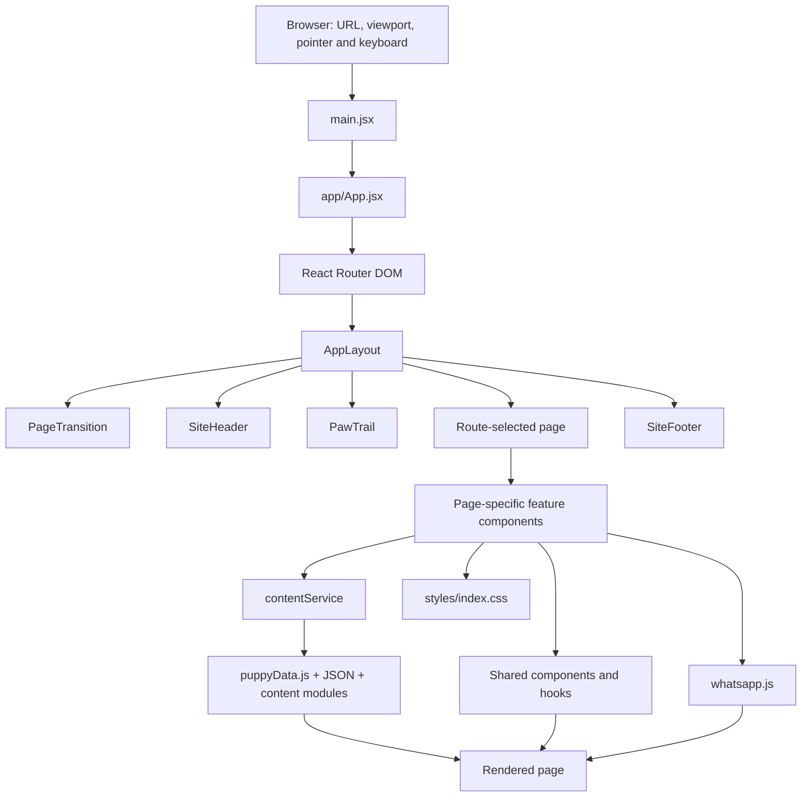
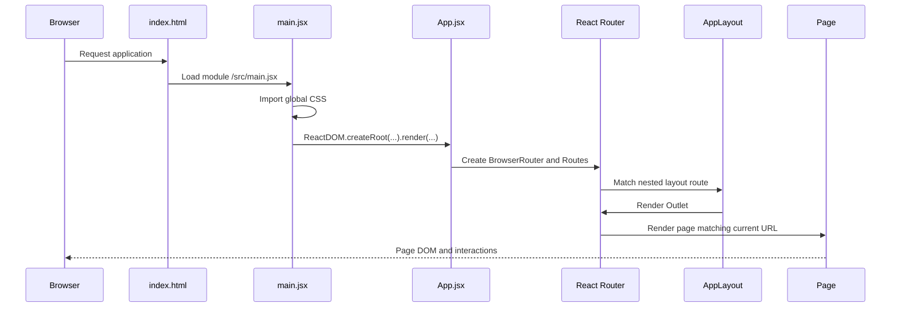
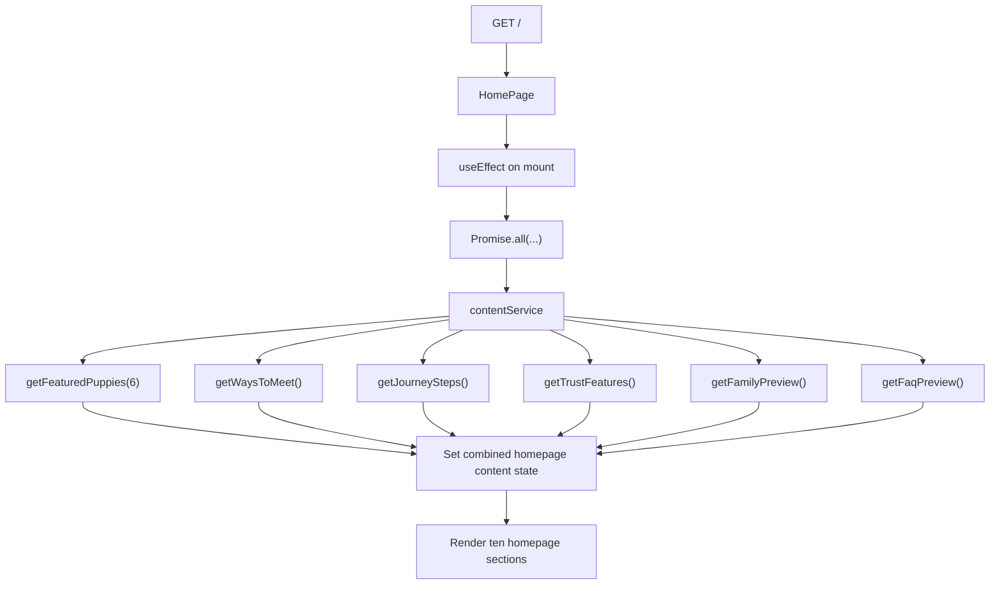
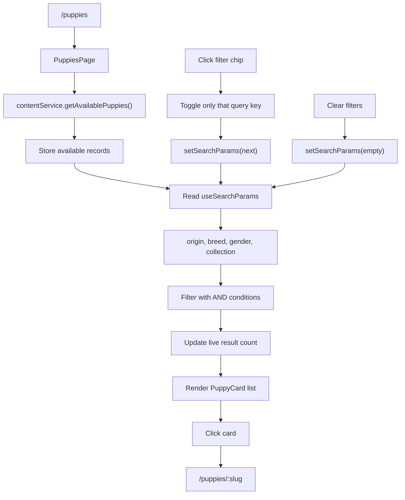
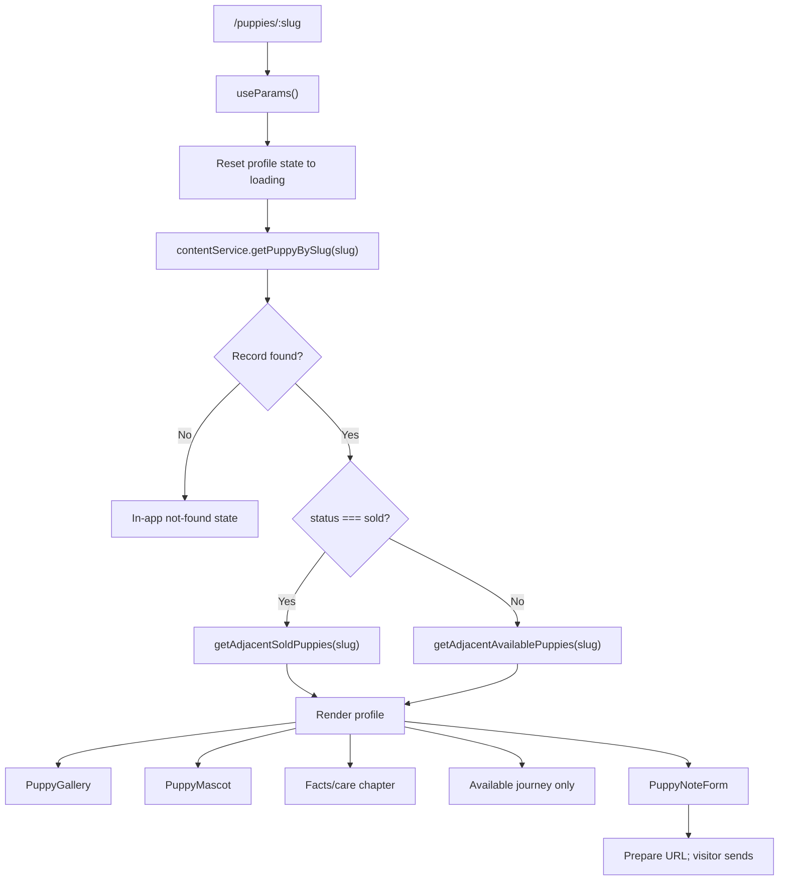
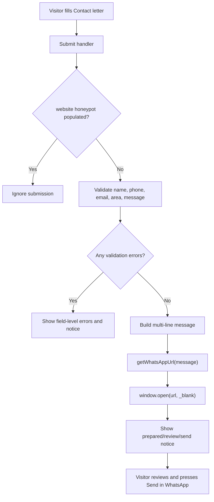
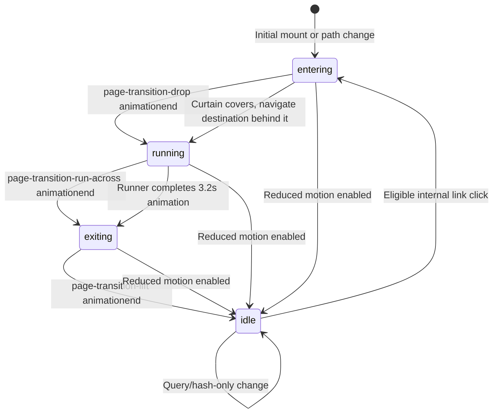
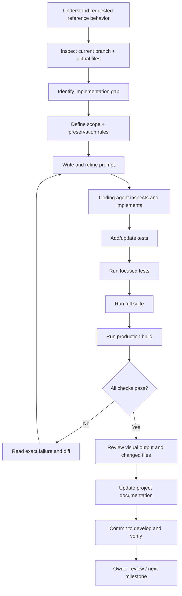

# TeddyPups Frontend Workflow & Implementation Deep-Dive

> **Purpose:** A practical engineering guide for understanding, explaining, demonstrating and defending the frontend implementation in a technical interview or Loom walkthrough. This is not only a feature list: it traces route ownership, component responsibilities, state transitions, data contracts, CSS behavior, browser APIs, tests, CI and current limitations.

| Snapshot metadata | Verified value |
|---|---|
| Repository | [`dikshaforsure/P-mart`](https://github.com/dikshaforsure/P-mart) |
| Branch | `develop` |
| Latest inspected commit | [`b541f6fcc27a3a8e342fb46d2554b6ad91680abf`](https://github.com/dikshaforsure/P-mart/commit/b541f6fcc27a3a8e342fb46d2554b6ad91680abf) |
| Commit subject | `test: dispatch named animation end events in jsdom` |
| Snapshot date | 25 November 2026 |
| Tracked repository files | 98 |
| Frontend implementation source/data/style files (excluding tests and readmes) | 54 |
| Frontend automated test files | 24 |
| Root project documents | 8 |
| Latest GitHub Actions run | [#72 — success](https://github.com/dikshaforsure/P-mart/actions/runs/45604070567) |
| Latest CI result | Focused: 5 files / 33 tests; complete: 24 files / 126 tests; build: Vite 8.3.8, 68 modules |
| Backend / database | Not implemented |
| Enquiry persistence | Not implemented; forms prepare a WhatsApp message for the visitor to send |
| Real-browser visual QA | Not established by CI; still requires owner/manual inspection |

**Important scope rule:** this guide describes the current frontend that exists on `develop`. The MERN backend, database, REST endpoints, authentication/admin, email delivery, enquiry persistence and production deployment appear in planning documents, but they are not implemented by the current source tree. Keep “proposed” and “implemented” separate when explaining the work.

---

## Contents

1. [Executive summary](#1-executive-summary)
2. [Technology stack and why each tool exists](#2-technology-stack-and-why-each-tool-exists)
3. [Repository structure and architectural layers](#3-repository-structure-and-architectural-layers)
4. [Application boot and route composition](#4-application-boot-and-route-composition)
5. [End-to-end workflow charts](#5-end-to-end-workflow-charts)
6. [Data model and service boundary](#6-data-model-and-service-boundary)
7. [Feature-by-feature implementation walkthrough](#7-feature-by-feature-implementation-walkthrough)
8. [Shared interaction and animation engineering](#8-shared-interaction-and-animation-engineering)
9. [CSS architecture and responsive behavior](#9-css-architecture-and-responsive-behavior)
10. [File-by-file repository register](#10-file-by-file-repository-register)
11. [Testing strategy and current CI evidence](#11-testing-strategy-and-current-ci-evidence)
12. [Development process, AI usage and prompt evidence](#12-development-process-ai-usage-and-prompt-evidence)
13. [Technical decisions, trade-offs and challenges](#13-technical-decisions-trade-offs-and-challenges)
14. [Known limitations, risks and honest answers](#14-known-limitations-risks-and-honest-answers)
15. [Loom recording plan and demo script](#15-loom-recording-plan-and-demo-script)
16. [Interview preparation: questions and model answers](#16-interview-preparation-questions-and-model-answers)
17. [Next steps and verification checklist](#17-next-steps-and-verification-checklist)
18. [Snapshot maintenance record](#18-snapshot-maintenance-record)

---

## 1. Executive summary

P-mart is a reference-faithful, multi-route public website frontend for TeddyPups U.A.E. The implementation is built as a React single-page application. It contains the shared site shell, homepage, available-puppy catalogue, reusable puppy profile route, Gone Home archive, Happy Families photo wall, How It Works page, FAQ page, Contact page and not-found route.

Its most important engineering characteristics are:

- **Route-driven UI:** React Router DOM maps public URLs to page components. All public pages are rendered inside one shared `AppLayout`.
- **Structured local data:** the 42 puppy records and the page-specific content snapshots live in JSON/JavaScript data files.
- **A service boundary:** page components call `contentService` methods rather than importing every data record directly. The current service is Promise-wrapped local data, not an HTTP client.
- **Reusable UI:** puppy cards, puppy profiles, galleries, mascot SVG, headings, journey steps and paw marks are kept in focused components.
- **URL-backed catalogue state:** origin, breed, gender and collection filters are encoded in query parameters, so the current filter state is linkable and survives reloads.
- **Accessible interaction patterns:** keyboard-operable tabs, dialog-based lightboxes, focus restoration, labels, status messages, keyboard navigation, touch swipes and reduced-motion handling are included in several experiences.
- **Browser-native animation APIs:** the puppy page-transition uses CSS animations and their `animationend` events; pointer trails and scroll behavior use browser events and timers with cleanup.
- **Automated regression checks:** Vitest and React Testing Library cover the route composition, data layer, UI behavior, forms, galleries and animation state flow.
- **A documented AI-assisted workflow:** one conversation handled engineering analysis/prompt design; a separate coding-agent conversation handled bounded implementation tasks; owner screenshot review drove visual follow-ups.

### Current product behavior

Visitors can browse the site, filter the currently available puppy snapshot, inspect available or sold puppy profiles, view mixed image/video media when URLs work, browse the 27 sold records in Gone Home, open the 64-image family gallery, compare local and imported journeys, search nine FAQ records, and prepare a WhatsApp enquiry.

### What it is not

The current repository does **not** contain a Node/Express server, MongoDB models, backend API routes, user/admin authentication, persisted enquiry records or an email notification service. A form can validate fields and open a prefilled WhatsApp URL, but the visitor still has to press Send in WhatsApp. The repository does not prove that the configured number, external image URLs or social destinations are operational or approved for production.

---

## 2. Technology stack and why each tool exists

| Technology/tool | Where it is used | What it does in this project | Interview explanation |
|---|---|---|---|
| React 19 | `frontend/src/**/*.jsx` | Component rendering, local UI state, effects, refs and composition | The UI is decomposed into reusable page, layout, feature and shared components. |
| JavaScript / JSX | All frontend source files | Application logic, UI markup and data mapping | The frontend is JavaScript-based; TypeScript is not used. |
| React Router DOM 7 | `app/App.jsx`, layout, page components | Browser routing, route parameters, links, navigation and query search params | URLs select the page; route parameters identify a puppy; query parameters encode catalogue filters. |
| Vite 8 | `vite.config.js`, npm scripts | Development server and production bundler | Vite provides quick local feedback and creates the deployable static frontend bundle. |
| Tailwind CSS 4 | `vite.config.js`, utility classes in JSX | Utility styling and its Vite integration | Tailwind utilities are used in several components, while much of the custom visual design lives in the shared CSS file. |
| CSS | `styles/index.css` | Tokens, layout, typography, breakpoints, visual motifs, transitions and keyframes | The detailed visual language and most animation rules are CSS-driven. |
| Vitest 5 | `vitest.config.js`, tests | Test runner | Runs unit/component/integration-style tests in the repository. |
| React Testing Library | `*.test.jsx` | Renders components and tests user-visible behavior | Tests query by roles, labels, names and actions rather than relying only on component internals. |
| jest-dom | `src/test/setup.js` | Additional DOM assertions | Provides assertions such as `toBeInTheDocument` and `toHaveAttribute`. |
| jsdom | Vitest config | Simulated DOM environment | Allows component tests in CI without launching a real browser. It does not render CSS like Chrome. |
| GitHub Actions | `.github/workflows/phase2-tests.yml` | Runs focused tests, full suite and production build on pushes/PRs to `develop` and manual dispatch | CI verifies the configured commands in a clean runner. |
| Google Fonts | `frontend/index.html` | Loads DM Sans, DM Serif Display, Fraunces and Manrope | Fonts are externally requested; test network access and production policy before deployment. |
| Browser APIs | CSS animation events, `IntersectionObserver`, `matchMedia`, `ResizeObserver`, `requestAnimationFrame`, history, `window.open` | Motion, visibility, scroll coordination and external handoff | Small interactions use native platform APIs; effects remove listeners/observers/timers on cleanup. |

### Package scripts

Run from the `frontend/` directory:

```bash
npm install
npm run dev
npm test
npm run test:watch
npm run build
npm run preview
```

The declared Node engine is `^20.19.0 || >=22.12.0`. GitHub Actions currently uses Node 22. The workflow uses `npm install --no-audit --no-fund`; it does not use `npm ci`.

### Vite configuration chain

```text
frontend/index.html
      |
      | loads /src/main.jsx
      v
Vite dev server / build
      |
      +-- @vitejs/plugin-react
      |
      +-- @tailwindcss/vite
      |
      v
React application + CSS bundle
```

`vite.config.js` registers the React and Tailwind Vite plugins and binds the dev server to `0.0.0.0`. `vitest.config.js` merges that Vite configuration and adds the jsdom test environment, setup file and test-file glob.

---

## 3. Repository structure and architectural layers

### Top-level structure

```text
P-mart/
├── .github/
│   └── workflows/
│       └── phase2-tests.yml
├── AGENT.md
├── AI_PROMPT_LOG.md
├── PROJECT_ANALYSIS.md
├── PROJECT_PROGRESS.md
├── README.md
├── TECHNICAL_DOCUMENTATION.md
├── TESTING.md
├── frontend-workflow.md
└── frontend/
    ├── .env.example
    ├── .gitignore
    ├── ASSET_SOURCES.md
    ├── README.md
    ├── index.html
    ├── package.json
    ├── vite.config.js
    ├── vitest.config.js
    └── src/
        ├── main.jsx
        ├── app/
        ├── animations/
        ├── assets/
        │   ├── images/
        │   └── videos/
        ├── components/
        │   ├── common/
        │   ├── home/
        │   ├── layout/
        │   ├── puppies/
        │   └── shared/
        ├── data/
        ├── hooks/
        ├── pages/
        ├── services/
        ├── styles/
        ├── test/
        └── utils/
```

### Layer responsibility



### Why the boundaries matter

- `main.jsx` should not contain page-specific business logic. It mounts the app and imports global CSS.
- `app/App.jsx` should decide which route component renders, not render each page's full markup.
- `AppLayout.jsx` owns the shared shell so header/footer/transition behavior is not copied into eight page components.
- Each page owns its page-specific loading/search/form/gallery/tab state.
- Reusable components own a repeated visual/interaction unit.
- Data files own the current content snapshot and structured records.
- `contentService.js` is the page-facing data boundary. It can later be replaced with real HTTP methods without requiring every component to know how data is stored.
- `styles/index.css` owns global design and component/page visual rules; its size and accumulated phase sections create a maintainability trade-off discussed later.

---

## 4. Application boot and route composition

### Boot sequence

1. Browser loads `frontend/index.html`.
2. The HTML provides the `#root` mount element and loads Google Font stylesheets.
3. Vite loads `src/main.jsx`.
4. `main.jsx` imports the main CSS file.
5. React creates the root and renders `App` under `React.StrictMode`.
6. `App.jsx` creates `BrowserRouter` and route definitions.
7. Each route is nested under `AppLayout`.
8. `AppLayout` mounts shared navigation, transition, pointer trail, scroll management, main outlet and footer.
9. The current URL selects the matching page.



### Route table

| URL | Component | Notes |
|---|---|---|
| `/` | `HomePage` | Homepage sections and content loading |
| `/puppies` | `PuppiesPage` | Available catalogue and filters |
| `/puppies/:slug` | `PuppyProfilePage` | Shared profile for available/sold records |
| `/gone-home` | `GoneHomePage` | Explicit sold-puppy ordering |
| `/happy-families` | `HappyFamiliesPage` | 64-item family photo wall and lightbox |
| `/how-it-works` | `HowItWorksPage` | Local/imported tabs and informational sections |
| `/faq` | `FaqPage` | Searchable FAQ notes |
| `/contact` | `ContactPage` | Contact details and WhatsApp letter |
| `*` | `NotFoundPage` | Unknown path fallback |

The `PlaceholderPage` component remains tracked but is not wired to the current completed routes in `App.jsx`. It is historical/reusable fallback code, not the active route implementation.

### Shared layout

`AppLayout` uses a fragment with the following children:

- `ScrollToTop`: handles SPA scroll reset and hash navigation.
- `PageTransition`: owns the full-screen route transition.
- `.app-page-content`: wraps the rest of the page and is set `inert` while the transition is active.
- `PawTrail`: global pointer trail.
- `SiteHeader`: desktop navigation and mobile dialog-like menu.
- `<main id="main-content"><Outlet /></main>`: route content slot.
- `SiteFooter`: shared footer and destinations.

The `inert` state is important: when the curtain is active, the underlying content is not merely visually covered; it is removed from normal user interaction/focus behavior.

---

## 5. End-to-end workflow charts

### 5.1 Homepage content workflow



The `active` flag in the effect prevents the promise completion from setting state after the component has unmounted. The current Promise-returning service wraps local arrays/objects with `Promise.resolve`; this is an architectural seam, not a server call.

### 5.2 Catalogue filter workflow



**Important implementation detail:** filters are conjunctive. If origin, breed and gender are selected, a puppy must satisfy all selected criteria. The `male-female` record is deliberately included in both boys and girls filter matches. Collection filtering checks `puppy.collections` metadata. Clicking one option preserves other parameters; selecting the same option toggles it off.

### 5.3 Puppy profile workflow



### 5.4 Contact form flow



Do not describe this as a submitted server enquiry. The page explicitly states that the message is prepared for WhatsApp; the visitor must complete the send action.

### 5.5 Page-transition lifecycle



The transition uses animation events to advance between phases; the phase durations are expressed in CSS. The component does not use a chain of JavaScript `setTimeout` calls to approximate the CSS animation's end.

---

## 6. Data model and service boundary

### 6.1 Main static data files

| File | Current purpose | Current volume |
|---|---|---:|
| `data/puppies.json` | Puppy records with status, identity, breed, origin, cover and gallery media metadata | 42 records |
| `data/breeds.json` | Breed reference records | 8 |
| `data/faq.json` | FAQ records as text strings | 9 |
| `data/families.json` | Full Happy Families image dataset | 64 |
| `data/home-families.json` | Separate family/home snapshot | 64 |
| `data/pages.json` | Reference page and route metadata snapshot | 49 route metadata keys |
| `data/siteContent.js` | Homepage/site copy, features, preview data and business settings | JS objects/arrays |
| `data/howItWorksContent.js` | Local/imported steps, promise, delivery and why-choose-us content | JS objects/arrays |

The 42 puppy records are the most important structured entity. Common fields include `id`, `slug`, `name`, `displayName`, `breed`, `gender`, `genderLabel`, `age`, `colour`, `description`, `status`, `featured`, `cover`, `media`, `origin`, `collections`, `breeds` and `published`. Individual optional values may differ by record, so components use fallbacks.

### 6.2 Puppy data selection and mapping

`puppyData.js` imports `puppies.json` and `breeds.json`, then derives application-friendly views:

- `allPuppies`: all 42 imported JSON records.
- `availablePuppies`: `status === 'available'` and not explicitly unpublished.
- `goneHomeOrder`: explicit slug array that defines the archive order.
- `goneHomePuppies`: records resolved through that order, filtered to sold/published.
- `getPuppyBySlug(slug)`: exact slug lookup.
- `getAdjacentAvailablePuppies(slug)`: previous and next available record with circular wrap-around.
- `getAdjacentSoldPuppies(slug)`: previous/next in the sold archive order with wrap-around.
- `toPuppyCardData(p)`: normalized card projection; retains cover/media/origin.
- `getAvailablePuppyCards(limit)`: featured data mapping with a safe limit.

Do not generate slugs by lowercasing names at runtime. URLs are mapped from the exact `slug` property.

### 6.3 Promise-based service facade

`contentService.js` imports local data/data helpers and returns Promise-wrapped values:

```js
const wait = value => Promise.resolve(value);

export const contentService = {
  getSiteSettings: () => wait(siteSettings),
  getFeaturedPuppies: (limit = 6) => wait(getAvailablePuppyCards(limit)),
  getAvailablePuppies: () => wait(availablePuppies),
  getPuppyBySlug: slug => wait(getPuppyBySlug(slug)),
  getAdjacentAvailablePuppies: slug => wait(getAdjacentAvailablePuppies(slug)),
  getAdjacentSoldPuppies: slug => wait(getAdjacentSoldPuppies(slug)),
  getBreeds: () => wait(breeds),
  getWaysToMeet: () => wait(waysToMeet),
  getJourneySteps: () => wait(journeySteps),
  getTrustFeatures: () => wait(trustFeatures),
  getFamilyPreview: () => wait(familyPreview),
  getFaqPreview: () => wait(faqPreview),
};
```

**What this abstraction achieves:** page components depend on stable method names and Promise results. If a real API is later approved, the service functions can change to `fetch(...)` and normalize HTTP errors without every page being rewritten.

**What it does not achieve today:** no HTTP request, no API base URL lookup, no response parsing, no database query and no persisted content. The Promise is immediately resolved from local in-memory imported data.

### 6.4 Contact settings and media metadata

`siteContent.js` currently contains the `siteSettings` object, including brand, region, phone display/tel, city and `whatsappNumber`. The current configured number is `971500000000` and display number is `+971 50 000 0000`; do not describe these as verified live contact credentials. Confirm the intended number before production use.

`referenceAssets.js` constructs external image URLs using the reference host's Next image endpoint. `ASSET_SOURCES.md` documents the media provenance and warns that public access is not permission to redistribute. No binary puppy/family media files were copied into the repository.

---

## 7. Feature-by-feature implementation walkthrough

### 7.1 Homepage

**Page:** `HomePage.jsx`

HomePage uses one effect and `Promise.all` to load six data groups: featured puppies, ways to meet, journey steps, trust features, family preview and FAQ preview. It stores the returned values as one `content` state object. Until the data resolves, it renders a loading message. Once loaded, it composes these sections in this order:

1. `HomeHero`
2. `BreedShowcase`
3. `FeaturedPuppies`
4. `WaysToMeet`
5. `PuppyJourney`
6. `WhatsAppEnquiry`
7. `TrustHighlights`
8. `HappyFamiliesPreview`
9. `FaqPreview`
10. `FinalCallToAction`

**Important section logic:**

- `HomeHero` shows up to six puppy portraits and profile links. A timer-driven cycle randomly makes one or two portraits dip. The component cleans up its timer and suppresses the cycle for reduced-motion users. It also renders the shared `PuppyMascot` and paw mark decorations.
- `BreedShowcase` duplicates a short six-label list to create a continuous CSS marquee. This is decorative, not a dynamic list of all breeds.
- `FeaturedPuppies` maps the selected puppy records into large card/door sections. It has image fallback behavior and optional video indicators.
- `WaysToMeet` uses static site content and mapped images for local and imported routes.
- `PuppyJourney` displays four visual milestones by splitting the third combined data description into two display steps. This is a presentation treatment, not a separate backend workflow.
- `WhatsAppEnquiry` is an illustration and WhatsApp links, not a live chat widget.
- `TrustHighlights` maps four trust feature objects.
- `HappyFamiliesPreview` shows a testimonial and four family images; it is not the full gallery.
- `FaqPreview` uses a small homepage FAQ subset and a local open-index accordion state.
- `FinalCallToAction` reuses `PuppyMascot` and offers WhatsApp and Contact links.

**How to explain the data flow:** `HomePage` coordinates loading; sections mostly receive props and render. This keeps the individual visual sections reusable and limits repeated data lookups.

### 7.2 Puppy catalogue

**Page:** `PuppiesPage.jsx`

1. On mount, it calls `contentService.getAvailablePuppies()`.
2. A local `active` boolean prevents state updates if the page unmounts before the Promise resolves.
3. It tracks three data states: not-yet-loaded (`null`), failed (`failed === true`) and loaded (array).
4. It reads filter values with `useSearchParams`.
5. It derives origin, breed and gender options from available data. Breed display order is explicitly set for a consistent UI.
6. `puppyHasBreed` supports records with an explicit `breeds` array and a fallback to normalized single `breed` text.
7. `filteredPuppies` uses AND logic over origin, breed, gender and collection.
8. `male-female` records match either gender filter.
9. `setFilter` clones the current `URLSearchParams`, toggles one key and preserves the other selected filters.
10. `clearFilters` resets query parameters.
11. The UI announces the current result count and renders `PuppyCard` items in source order.

**Why URL-backed filters:** users can copy/share a filtered URL, refresh and retain the selection, and use browser navigation to move between filter states.

**Potential interview question — “Why not keep filters only in React state?”**  
Because filters represent navigable page state. Query parameters make the state addressable and shareable; local state remains appropriate for transient UI state such as a menu being open.

### 7.3 Puppy cards

**Component:** `PuppyCard.jsx`

- Receives one puppy record and an index.
- Computes a display name and gender label with fallbacks.
- Uses `cover.focalX`/`cover.focalY` to derive CSS `object-position`.
- Shows an image only for image covers with a URL that has not failed.
- Stores a failed-image boolean and switches to a designed fallback when `onError` fires.
- Computes a deterministic slight tilt and pastel wash from the card index.
- Shows an availability sticker and a video indicator when any media record has `kind === 'video'`.
- Wraps the content in a React Router `Link` using the exact slug.

The card is a list item (`li`) because its parent is a semantic list.

### 7.4 Puppy profile

**Page:** `PuppyProfilePage.jsx`

- Reads `slug` from `useParams`.
- Starts with `puppy === undefined` for the loading state.
- Clears old puppy and neighbor state when the slug changes.
- Loads the exact record through `getPuppyBySlug`.
- Chooses available or sold adjacency based on `status`.
- Uses an `active` flag to avoid stale Promise completion after navigation.
- `puppy === null` represents not found or lookup failure; `puppy === undefined` represents loading.
- Derives display name, availability, imported status, gender, origin and WhatsApp message.
- Available records have the four-chapter structure including journey; sold records have the reduced historical structure and no available-journey chapter.
- Renders `PuppyGallery`, `PuppyMascot`, facts/care and `PuppyNoteForm`.
- The profile ribbon updates with scroll position using a single scheduled animation frame and a `ResizeObserver`; it exits when reduced motion is enabled and cleans listeners/observer/frame on cleanup.

**Important design distinction:** a sold profile remains accessible as a historical story and can route an enquiry toward similar currently available puppies. It is not treated as a purchasable available listing.

### 7.5 Puppy gallery

**Component:** `PuppyGallery.jsx`

- Selects `puppy.media` when available; falls back to the cover record otherwise.
- Tracks `activeIndex`, failed media, lightbox state and refs to the dialog/video/touch starting point.
- Resets active item, failed-state map and lightbox state when `puppy.slug` changes.
- Uses `kind` to choose `` or `<video>`.
- Preserves focal point metadata for the cropped stage.
- Supports previous/next with modular index arithmetic.
- Shows thumbnails; video thumbnails use `poster.url` when present.
- Formats `durationS` into `m:ss`.
- A native `<dialog>` provides the lightbox. It attempts `showModal()` where available and has a fallback `open` attribute for test environments.
- Stores prior focus, locks body scrolling, focuses the close control and restores the previous focus/overflow on cleanup.
- ArrowLeft/ArrowRight moves through items.
- Touch swipes greater than 45px move to the adjacent item.
- The full-screen image uses `object-fit: contain` so original portrait/landscape content is not cropped.
- Video uses native controls, `playsInline`, metadata preload and poster where available.
- Failed URLs become a status fallback rather than breaking the whole gallery.

**Why cover and contain are different:** the main stage intentionally fills a fixed image frame with a crop; the lightbox is for inspecting the entire original media, so it uses contain.

### 7.6 Gone Home

**Page:** `GoneHomePage.jsx`

- Imports the explicit sold archive order through `puppyData.js`.
- Maps the 27 sold records into ticket-style visual cards.
- Links each card to its historical `/puppies/:slug` profile.
- Reuses cover metadata/focal positioning and handles missing cover with a designed fallback.
- The current dataset includes one sold record without media (`poodle-molly-female`), so it should not be described as having a real photo.

### 7.7 Happy Families

**Page:** `HappyFamiliesPage.jsx`

- Uses the 64 family records from `families.json`.
- Displays a featured group of four items and the remaining sixty in the lower photo wall.
- Builds one indexed media sequence for the lightbox so navigation order remains source order across the featured/lower split.
- Uses provided alt text, caption, intrinsic width/height and focal metadata.
- Uses a native dialog-like lightbox experience with previous/next, keyboard arrows, touch gestures, focus restore and body-scroll locking.
- Full-size media uses contain so portrait and landscape originals remain intact.
- Image errors use fallbacks.
- The `home-families.json` file is separate from the full family gallery dataset; do not confuse the 8 homepage preview moments in `siteContent.js` with the 64 gallery records.

### 7.8 How It Works

**Page:** `HowItWorksPage.jsx`

- Reads local/imported journey content from `howItWorksContent.js`.
- Maintains `activeJourney` state (`local` or `imported`).
- Uses a `tabRefs` object to focus the selected tab.
- `handleTabKeyDown` supports ArrowLeft/ArrowRight, ArrowUp/ArrowDown, Home and End.
- Each tab has `aria-selected`, `aria-controls` and roving `tabIndex`.
- Each panel is a `tabpanel` associated with its tab and hidden when inactive.
- `JourneyStep` renders a reusable numbered item.
- The rest of the page uses static data arrays for promise, delivery options and why-choose-us content.
- Internal table-of-contents anchors jump to the four named sections.
- WhatsApp CTA uses the shared helper.

### 7.9 FAQ

**Page:** `FaqPage.jsx`

- Imports the nine records in `faq.json`.
- `splitFaqRecord` separates text at the first question mark. It is a parser for this current text format, not a general FAQ schema.
- `useMemo` creates parsed entries once.
- Search is normalized by trimming and lowercasing.
- Filtering searches both question and answer.
- Result count is updated in an `aria-live` region.
- Each `FaqNote` owns its own `open` state.
- Button `aria-expanded` and `aria-controls` connect question to answer region.
- An empty state suggests a WhatsApp follow-up.

### 7.10 Contact form

**Page:** `ContactPage.jsx`

- Stores the field values in one object state: name, phone, email, area, puppyId and message.
- Stores validation errors, notice text, handoff URL and image error state separately.
- `updateField` updates one field, clears its current error and clears prior handoff feedback.
- `validateFields` enforces a 2–80 character name, non-empty valid phone with 7–15 digits after allowed formatting cleanup, optional valid email, area max 80 and message max 2,000.
- The form checks a hidden `website` honeypot field; a populated value is ignored.
- On success it assembles a multi-line message, uses `getWhatsAppUrl`, and opens a new tab with `window.open`.
- The UI explains that the visitor must review and press Send in WhatsApp. It does not show a false “message sent” success.
- Contact details include the configured email, Downtown Dubai location and a Google Maps link.
- The showroom image uses a dedicated error fallback.
- Puppy options are currently an explicit static list in the component; they are not dynamically fetched from the puppy catalogue.

### 7.11 Puppy-specific note form

**Component:** `PuppyNoteForm.jsx`

- Receives the current puppy and an optional decorative stamp.
- Adjusts the title, explanation and message wording when the profile is sold.
- Stores visitor fields and validation errors locally.
- Requires name and phone; email is optional but validated if present.
- Prepares a profile-specific WhatsApp message containing the puppy name and slug.
- For sold puppy, explains that the puppy has already found a home and asks about similar puppies.
- Opens WhatsApp; visitor manually sends the message.
- Test coverage includes validation and correct sold-puppy messaging.

---

## 8. Shared interaction and animation engineering

### 8.1 PageTransition: current implementation

**Files:** `PageTransition.jsx`, `TeddyRunner.jsx`, `PawMark.jsx`, transition section in `styles/index.css`.

The curtain now runs on the initial application mount and on eligible route changes. Its React phases are:

1. `entering`: the full-screen curtain drops into place.
2. `running`: the dog crosses while pawprints appear behind it.
3. `exiting`: the curtain lifts upward.
4. `idle`: component returns `null`.

`PageTransition` listens to the router's `pathname` with `useLocation`, and `useNavigate` commits an intercepted internal navigation after the curtain covers the viewport.

**Eligible anchor click logic:**

- Only primary-button unmodified clicks are intercepted.
- Modified clicks (Ctrl/Cmd/Shift/Alt) are allowed to behave normally.
- Download links and `data-no-transition` links are ignored.
- Links targeting a non-`_self` tab/window are ignored.
- `rel="external"` is ignored.
- Cross-origin links are ignored.
- Query-only/hash-only links with the same pathname do not trigger the curtain.
- Duplicate clicks during an active transition are prevented.
- The destination is held in `pendingNavigation`, then router navigation is committed after the `page-transition-drop` animation ends.
- Browser back/forward and programmatic path changes cannot be intercepted before the router commits, so a layout effect covers the destination before paint.
- Reduced-motion preference cancels/skips the visual transition and returns to idle.

**Transition timings and layout:**

| Part | Current value |
|---|---:|
| Curtain entrance | 440ms |
| Runner phase | 3,200ms |
| Curtain exit | 540ms |
| Runner viewBox | `0 0 300 240` |
| Runner width | CSS clamp around 100px–172px |
| Horizontal runner path | Begins at `-110%`, ends at `58vw` |
| Pawprints | 5 |
| Pawprint X positions | 27%, 31.5%, 36%, 40.5%, 45% |
| Pawprint opacity after imprint | 0.88 |
| Reduced motion | CSS animation disabled; stable visible transition state is used |

The current React code computes paw delays from the actual viewport width and a clamped runner width so pawprints are stamped after Teddy passes each horizontal location. The CSS runner dimensions and JS delay calculation must stay synchronized.

### 8.2 TeddyRunner SVG anatomy

`TeddyRunner.jsx` is a dedicated inline SVG component. It is not a raster image and it is not the normal sitting mascot embedded in the page.

It uses `viewBox="0 0 300 240"` and separate semantic `data-part` groups, including:

- `ground-shadow`
- `tail`
- `body`
- `collar`
- `head`
- `left-ear`
- `right-ear`
- `eyes`
- `nose`
- `mouth`
- `tongue`
- `rear-far-leg`
- `front-far-leg`
- `rear-near-leg`
- `front-near-leg`

Each leg has its own group and transform origin so CSS can animate the limbs independently. The body bounces, the head bobs, tail wags, ears flop with alternating phase, and four legs run on out-of-phase cycles. The mascot's outline/fur colors are consistent with the site's existing puppy drawing.

The SVG test checks the viewBox, required part names and four leg groups. It does **not** visually render the gait or prove that the artwork matches the screenshot.

### 8.3 Why the latest transition test needed a follow-up

The transition component relies on actual CSS `animationend` events and checks `event.animationName` to move between phases. The test suite runs in jsdom, which does not run CSS animation timelines.

The latest test helper therefore constructs a native `Event('animationend', { bubbles: true })`, sets its `animationName`, and dispatches it with `fireEvent(element, event)`. It does not wait real seconds; it deterministically advances the lifecycle as if the browser animation ended.

This is a useful engineering lesson: **jsdom tests simulate the event contract; a real browser is still needed to inspect the animation itself.**

### 8.4 PawTrail: cursor movement stamps

`PawTrail.jsx` is separate from the route-transition pawprints.

It listens to `pointermove` only when the device reports a fine pointer and hover support, and when reduced motion is not requested. It accepts mouse and pen, but ignores touch pointer movement. It uses:

- 84px minimum distance between stamps,
- 220ms minimum interval,
- 2,200ms lifetime,
- maximum seven active marks,
- direction calculated with `Math.atan2`,
- alternating rotation/tone,
- timers stored in a ref and cleared on unmount.

It renders `PawMark` in an `aria-hidden` fixed visual layer. It returns `null` while no marks exist.

### 8.5 ScrollToTop

`ScrollToTop.jsx` uses `useLocation` and `useLayoutEffect`:

- Sets `history.scrollRestoration = 'manual'` while mounted and restores previous browser setting on cleanup.
- If URL contains a hash, decodes the ID, finds the element and scrolls to it.
- Otherwise scrolls to top immediately.
- Dependencies are `[pathname, hash]`; query-only catalogue filter updates do not reset scroll.

### 8.6 SiteHeader mobile navigation

`SiteHeader.jsx`:

- Defines six navigation links in one array and renders desktop/mobile variants.
- Uses `NavLink` for active state.
- Closes the menu on pathname change.
- When opened, focuses the close control and adds `menu-open` to the body.
- Escape closes and restores focus to the trigger.
- Tab/Shift+Tab are trapped between mobile nav controls.
- Cleanup removes the keydown listener and body class.
- The mobile menu is marked as a dialog, hidden/inert when closed.

### 8.7 PuppyMascot reveal behavior

`PuppyMascot.jsx` is a large inline SVG mascot. It receives display props such as `puppyName`, `label`, `facing`, `showRing`, `bubbleText` and `boardRef`.

It uses an `IntersectionObserver` to mark its board `data-revealed="true"` once visible, then unobserves. It reveals immediately when reduced motion is enabled or IntersectionObserver is unavailable. Its SVG contains independently addressable groups and path data for body, head, paws, tail, eyes, ears, mouth and expression layers. It is reused in profile, contact and homepage contexts, while `TeddyRunner` is a separate running composition for transitions.

### 8.8 useScrollReveal

The hook returns a ref. On mount it finds the element and either immediately applies `is-visible` for reduced motion/no IntersectionObserver, or observes it and adds the class once the visibility threshold is met. It disconnects on cleanup. It is a one-time reveal, not a continuous scroll progress effect.

---

## 9. CSS architecture and responsive behavior

### 9.1 Current organization

`frontend/src/styles/index.css` is approximately 174 KB and 3,583 lines in the inspected snapshot. It contains a large shared stylesheet that accumulated feature sections as phases were implemented. The file is not split into a separate CSS module per page.

Major section markers and approximate line locations:

| Lines | Section |
|---:|---|
| 1–54 | Theme variables/base styles/shared primitives |
| 55–83 | Header and navigation |
| 84–112 | Initial homepage/hero and breed marquee |
| 113–215 | Homepage feature sections |
| 216–348 | Footer/placeholders, responsive breakpoints and reduced motion |
| 349–366 | Remote reference-host media rules |
| 367–514 | Phase 2 catalogue/profile baseline styles |
| 515–620 | Sketchbook catalogue refinements |
| 621–995 | Profile visuals, gallery and mascot motion |
| 996–1380 | Profile paper panel, journey, forms, adjacent cards and responsive rules |
| 1381–1789 | Shared shell, PageIntro, How It Works and FAQ |
| 1790–2625 | Gone Home, Happy Families and Contact |
| 2626–3072 | Homepage storybook refinement and screenshot corrections |
| 3073–3356 | Global paw cursor/trail and mascot interaction refinements |
| 3357–3583 | Page-transition curtain, runner gait, pawprints, message and reduced motion |

Line positions are a snapshot guide; use section comments/search when the file changes.

### 9.2 Design tokens and visual motifs

The stylesheet contains palette, typography and spacing values used to maintain a consistent visual language. Across sections the repeated motifs include:

- warm paper/cream backgrounds,
- cocoa/toffee/honey colors,
- hand-drawn outlines,
- rounded/irregular card shapes,
- paw marks,
- ticket and Polaroid motifs,
- editorial serif and handwritten display type,
- animated reveal, hover and mascot effects.

### 9.3 Responsive behavior

The stylesheet contains multiple page-specific breakpoints, including around 1100px, 1024px, 1023px, 820px, 768px, 760px, 720px, 700px, 600px, 520px, 420px, 380px, 360px and 1280px minimum widths. Not every breakpoint applies globally; many are scoped to one page section.

Important responsive practices in the code include:

- Catalogue grid adjusts columns and gaps.
- Profile storybook chapters and ribbon adapt to narrower viewports.
- How It Works journey cards and tab switcher collapse.
- Family photo wall changes arrangement.
- Contact layout changes ordering and form widths.
- Homepage puppy lineup and CTA spacing adapt.
- Mobile touch layout cannot depend exclusively on hover effects.
- Reduced-motion rules disable non-essential keyframes/transitions across the site and the transition runner.

### 9.4 Maintainability trade-off

The central stylesheet is effective for preserving a consistent visual system and phase-by-phase work, but at 3,583 lines it is difficult to navigate and has accumulated successive overrides. Future changes should remain page-scoped and be tested for cross-page effects. A future CSS refactor should be its own task, not mixed into a feature fix.

---

## 10. File-by-file repository register

The following register covers all 98 tracked files in the inspected `develop` tree. It distinguishes production source, tests, documentation, config, and directory notes. Files with binary/image/video content are not present in this inventory as actual asset files; their directories contain README placeholders.

### 10.1 Root documents (8 files)

| File | Role and how to use it |
|---|---|
| `AGENT.md` | Operating instructions and project guardrails for coding-agent work. Read before implementing changes; it contains project-specific constraints, preservation rules, testing expectations and development workflow. It is a working instruction document, not source code. |
| `AI_PROMPT_LOG.md` | Historical log of AI-assisted sessions, objectives, tools, changed files and reported checks. It explicitly labels many prompts as faithful summaries/reconstructed briefs rather than verbatim messages; model/version is only named when evidence exists. |
| `PROJECT_ANALYSIS.md` | Reference-site research, route inventory, comparison notes, data/content risks and phase-by-phase findings. Use it to understand why page behaviors/content were implemented. |
| `PROJECT_PROGRESS.md` | Phase roadmap, completion notes, commits, verification records and open tasks. Older entries are historical snapshots; use latest dated sections for current status. |
| `README.md` | Minimal root README with the project heading. It currently adds little setup detail; use `frontend/README.md` for frontend commands. |
| `TECHNICAL_DOCUMENTATION.md` | Architecture/API/database/deployment design proposal plus later implementation notes. The initial MERN architecture is a proposal; current source does not contain the planned backend. |
| `TESTING.md` | Testing matrix and dated execution evidence. Distinguish planned checks from executed tests and historical pass counts from the current CI run. |
| `frontend-workflow.md` | This implementation deep-dive, file register, explanation and Loom preparation guide. Update snapshot metadata and evidence after future commits. |

### 10.2 GitHub Actions and frontend config (9 files)

| File | Responsibility |
|---|---|
| `.github/workflows/phase2-tests.yml` | GitHub Actions workflow. Triggers on push to `develop`, pull requests targeting `develop`, and manual dispatch. Uses read-only contents permission, checks out the repo, sets up Node 22, installs frontend dependencies, runs focused public-page/route tests, runs the full test suite, then builds production. |
| `frontend/.env.example` | Placeholder for environment configuration. Current frontend service does not make HTTP calls, so do not claim a live API configuration is consumed. |
| `frontend/.gitignore` | Ignores frontend-generated and local-only files such as dependencies/build outputs and environment files. |
| `frontend/ASSET_SOURCES.md` | Asset provenance, media-source notes, URL limitations and rights caution. Important when discussing where media comes from and what must be approved. |
| `frontend/README.md` | Frontend setup commands, Node requirements, folder overview, data/route notes and historic phase notes. Some early phase text is intentionally historical and not a reliable current status summary. |
| `frontend/index.html` | Vite HTML entry document: language, viewport, theme, description, title, Google Font preconnect/import, `#root`, and `/src/main.jsx` module script. |
| `frontend/package.json` | Dependency versions, Node engine and dev/test/build scripts. |
| `frontend/vite.config.js` | Vite plugins: React and Tailwind CSS; dev server listens on `0.0.0.0`. |
| `frontend/vitest.config.js` | Merges Vite config and sets jsdom, test setup file, test file glob and mock cleanup/restore behavior. |

### 10.3 Source directory notes (3 files)

| File | Responsibility |
|---|---|
| `frontend/src/animations/README.md` | Animation conventions: prefer CSS for small effects, use IntersectionObserver for one-time reveal, clean observers/listeners/RAF, respect reduced motion and avoid unnecessary dependencies. |
| `frontend/src/assets/images/README.md` | Explains no approved local image bundle is currently committed and records the remote-reference asset approach and approval requirement. |
| `frontend/src/assets/videos/README.md` | Notes that no local video files were added; future approved videos should include posters and metadata. |

### 10.4 Runtime, router and shared layout (15 files)

| File | Responsibility and connections |
|---|---|
| `frontend/src/main.jsx` | React entry point. Imports React, `createRoot`, `App` and global CSS; mounts `<App />` inside `<React.StrictMode />` to `#root`. |
| `frontend/src/app/App.jsx` | Defines BrowserRouter and all route paths. Nests pages below AppLayout and maps `puppies/:slug` to the reusable profile component. |
| `frontend/src/app/App.test.jsx` | Integration-style route suite. Creates App at different history paths and checks that each URL renders the expected page and shared navigation/footer. |
| `frontend/src/components/layout/AppLayout.jsx` | Global shell owner. Mounts scroll manager, transition, inert content wrapper, PawTrail, header, main Outlet and footer. |
| `frontend/src/components/layout/PageTransition.jsx` | Full-screen route/initial transition state machine. Intercepts eligible links, stores a pending route, calls navigate after curtain drop, listens for named animation-end events and respects reduced motion. |
| `frontend/src/components/layout/PageTransition.test.jsx` | Tests initial lifecycle, internal navigation, five paw stamps and delays, runner SVG anatomy, query/hash bypass, external/new-tab/download bypass, back/forward, reduced motion, resize and cleanup. |
| `frontend/src/components/layout/PawTrail.jsx` | Global pointer trail: fine-pointer/reduced-motion gate, distance/time spacing, direction/rotation, cap, lifetime timers and cleanup. Uses PawMark. |
| `frontend/src/components/layout/PawTrail.test.jsx` | Tests pointer support, minimum spacing, print limit/removal, tone/direction and listener/timer cleanup. |
| `frontend/src/components/layout/ScrollToTop.jsx` | Disables browser automatic scroll restoration while mounted, handles URL hash targets and resets top on pathname/hash changes. |
| `frontend/src/components/layout/ScrollToTop.test.jsx` | Tests path scroll reset, hash scrolling and query-only scroll preservation/restoration setting. |
| `frontend/src/components/layout/SiteHeader.jsx` | Desktop/mobile nav, active NavLink, menu state, close-on-navigation, focus movement, Escape, tab trap and body scroll lock. Uses PawMark and WhatsApp helper. |
| `frontend/src/components/layout/SiteHeader.test.jsx` | Tests navigation, menu open/close, active route, focus, keyboard and scroll-lock behavior. |
| `frontend/src/components/layout/SiteFooter.jsx` | Shared footer with home/section links, contact email/location, WhatsApp helper and social destinations. |
| `frontend/src/components/layout/SiteFooter.test.jsx` | Tests footer destinations, labels and route links. |
| `frontend/src/components/layout/TeddyRunner.jsx` | Dedicated inline SVG runner for PageTransition. Separate body/head/tail/ears/four legs/facial/ground-shadow SVG groups allow independent CSS gait motion. |

### 10.5 Common/shared UI components (6 files)

| File | Responsibility |
|---|---|
| `frontend/src/components/common/ArrowLink.jsx` | Small wrapper for internal React Router links or external anchors, appending an accessible decorative arrow. |
| `frontend/src/components/common/SectionHeading.jsx` | Reusable standard heading with optional eyebrow, title, description, light theme and centered alignment. |
| `frontend/src/components/shared/JourneyStep.jsx` | Reusable numbered journey list item used by How It Works. |
| `frontend/src/components/shared/PageIntro.jsx` | Shared page intro header with optional eyebrow, title, description and extra class. Used on informational pages. |
| `frontend/src/components/shared/PawMark.jsx` | Single inline SVG paw mark reused in nav, footer, cards, trails and decorations. |
| `frontend/src/components/shared/SectionHeading.jsx` | Storybook heading variant with section number, eyebrow, title, description and optional id. Kept separate from the common heading because the visual markup differs. |

### 10.6 Homepage feature modules (14 files)

| File | Responsibility and relationship |
|---|---|
| `frontend/src/components/home/BreedShowcase.jsx` | Decorative marquee of six selected puppy/breed labels, duplicated for a continuous CSS loop; uses PawMark. |
| `frontend/src/components/home/FaqPreview.jsx` | Small homepage FAQ accordion, first item initially open, local `openIndex`, link to full FAQ. |
| `frontend/src/components/home/FeaturedPuppies.jsx` | Maps featured puppy props into image/door/profile cards, with fallback, focal point and video marker. |
| `frontend/src/components/home/FeaturedPuppies.test.jsx` | Checks featured puppy links, details, image metadata, video marker and failure fallback. |
| `frontend/src/components/home/FinalCallToAction.jsx` | Final CTA section with WhatsApp link, Contact link, copy and shared PuppyMascot. |
| `frontend/src/components/home/HappyFamiliesPreview.jsx` | Renders testimonial and four images from family preview data and `referenceAssets.familyMoments`. |
| `frontend/src/components/home/HappyFamiliesPreview.test.jsx` | Verifies preview item/image mapping, captions and lazy-loading behavior. |
| `frontend/src/components/home/HomeHero.jsx` | Main homepage hero. Renders copy/CTAs, six puppy links, mascot, image positions and a randomized portrait dip cycle with timers and reduced-motion handling. |
| `frontend/src/components/home/HomeHero.test.jsx` | Tests hero text, CTAs, puppy destinations, image positions, controlled dip cycle and reduced-motion behavior. |
| `frontend/src/components/home/PuppyJourney.jsx` | Renders four visual journey milestones from homepage journey data; splits an existing combined step for presentation. |
| `frontend/src/components/home/PuppyJourney.test.jsx` | Verifies the rendered four-step split uses the source text without inventing a new process. |
| `frontend/src/components/home/TrustHighlights.jsx` | Maps trust feature objects into numbered cards/stamps and heading. |
| `frontend/src/components/home/WaysToMeet.jsx` | Local and imported cards; uses static site data, mapped images, links and paw signpost. |
| `frontend/src/components/home/WhatsAppEnquiry.jsx` | Illustrative conversation card and WhatsApp deep links; explicitly not a live chat or message receiver. |

### 10.7 Puppy components (8 files)

| File | Responsibility |
|---|---|
| `frontend/src/components/puppies/PuppyCard.jsx` | Sketch-style catalogue card with exact profile link, focal image crop, fallback, availability/video labels, tilt/wash and SVG doodles. |
| `frontend/src/components/puppies/PuppyCard.test.jsx` | Tests accessible card name, profile URL, metadata, focal point, video label and failed-image fallback. |
| `frontend/src/components/puppies/PuppyGallery.jsx` | Mixed image/video carousel, thumbnails, navigation, native dialog, focus/scroll management, keyboard/touch controls, error states and contain-fit fullscreen media. |
| `frontend/src/components/puppies/PuppyGallery.test.jsx` | Tests image/video render, navigation, thumbnail, lightbox, keyboard/touch, failure, per-puppy reset and aspect ratio. |
| `frontend/src/components/puppies/PuppyMascot.jsx` | Main brand mascot inline SVG with reveal observer and presentation props. SVG groups support head/body/eyes/ears/tail/paws/expressions. |
| `frontend/src/components/puppies/PuppyMascot.test.jsx` | Tests mascot SVG structure/accessibility, props, observer reveal/cleanup and reduced-motion fallback. |
| `frontend/src/components/puppies/PuppyNoteForm.jsx` | Puppy-specific local form; validates fields, produces available/sold-specific WhatsApp message and shows manual-send status. |
| `frontend/src/components/puppies/PuppyNoteForm.test.jsx` | Tests validation, popup behavior, message composition and sold-profile wording. |

### 10.8 Data and data tests (11 files)

| File | Responsibility |
|---|---|
| `frontend/src/data/breeds.json` | Eight breed records used as breed reference data. |
| `frontend/src/data/families.json` | Full 64-item family gallery records with media metadata, alt text, captions, dimensions and focal/color/blur fields. |
| `frontend/src/data/faq.json` | Nine FAQ text records; current page splits each record at its first question mark. |
| `frontend/src/data/home-families.json` | Separate 64-record home/family snapshot; do not assume it is identical in meaning/order to the full page's data without comparison. |
| `frontend/src/data/howItWorksContent.js` | Local/imported four-step journey objects, promise items, delivery choices and why-choose-us list. |
| `frontend/src/data/pages.json` | Reference route/page metadata snapshot, including paths, page title/template metadata. It is not the active React Router configuration. |
| `frontend/src/data/puppies.json` | Canonical 42 puppy records: 15 available and 27 sold with slugs, status, origins, breed, cover and media metadata. |
| `frontend/src/data/puppyData.js` | Derived available/sold arrays, exact lookup, explicit Gone Home order, adjacency and card mapping helpers. |
| `frontend/src/data/puppyData.test.js` | Tests counts, uniqueness, filtering, lookup, archive order, adjacency/wrap-around and data projection. |
| `frontend/src/data/referenceAssets.js` | Remote reference-host image URL builder and maps for hero, showroom, featured puppies and homepage family moments. No local binaries. |
| `frontend/src/data/siteContent.js` | Site settings and homepage content arrays/objects: ways, journey, trust, family quote/moments and FAQ preview. |

### 10.9 Pages and page tests (17 files)

| File | Responsibility |
|---|---|
| `frontend/src/pages/ContactPage.jsx` | Contact details/map/showroom image fallback and validated WhatsApp letter with honeypot. |
| `frontend/src/pages/ContactPage.test.jsx` | Tests form field order, validation, WhatsApp message, manual-send feedback and honeypot. |
| `frontend/src/pages/FaqPage.jsx` | FAQ text parsing, question/answer search, count, clear, empty state, accordion and WhatsApp follow-up. |
| `frontend/src/pages/FaqPage.test.jsx` | Tests all FAQ records, text search, count, clear, accordion ARIA and no-result path. |
| `frontend/src/pages/GoneHomePage.jsx` | 27 source-ordered sold ticket cards, profile links and missing-image fallback. |
| `frontend/src/pages/GoneHomePage.test.jsx` | Tests sold records/order, ticket structure, links and fallback. |
| `frontend/src/pages/HappyFamiliesPage.jsx` | 64-photo page with four featured + sixty remaining cards, testimonial and accessible photo viewer. |
| `frontend/src/pages/HappyFamiliesPage.test.jsx` | Tests 64 records/source order, captions/alt, 4+60 split, lightbox, keyboard/touch, focus, fallback and aspect ratio. |
| `frontend/src/pages/HomePage.jsx` | Homepage data coordinator and composition of ten homepage sections. |
| `frontend/src/pages/HowItWorksPage.jsx` | Local/imported tab interaction, keyboard navigation, TOC, journeys, promise/delivery/why and WhatsApp CTA. |
| `frontend/src/pages/HowItWorksPage.test.jsx` | Tests page sections, tab/panel behavior, journey steps and keyboard handling. |
| `frontend/src/pages/NotFoundPage.jsx` | Wildcard page fallback and return-home action. |
| `frontend/src/pages/PlaceholderPage.jsx` | Generic older placeholder component; currently not selected by App route definitions. |
| `frontend/src/pages/PuppiesPage.jsx` | Catalogue load/error/empty states, URL-backed filters, filter options, AND logic, result count and PuppyCard list. |
| `frontend/src/pages/PuppiesPage.test.jsx` | Tests catalogue records, filters, counts, loading/empty and service failure. |
| `frontend/src/pages/PuppyProfilePage.jsx` | Exact-slug profile, available/sold hierarchy, gallery, mascot, journey/care, note form, adjacency and scroll ribbon. |
| `frontend/src/pages/PuppyProfilePage.test.jsx` | Tests available/sold profile differences, gallery/data, navigation, missing/error states and profile structure. |

### 10.10 Services, hooks, styles, tests and utility (7 files)

| File | Responsibility |
|---|---|
| `frontend/src/services/contentService.js` | Promise-wrapped static-data facade used by pages/components. It is not an HTTP API. |
| `frontend/src/services/contentService.test.js` | Tests service methods and returned local data values. |
| `frontend/src/hooks/useScrollReveal.js` | IntersectionObserver hook that adds `is-visible` once; reduced-motion/unavailable-observer fallback; cleanup. |
| `frontend/src/styles/index.css` | Main 3,583-line stylesheet: tokens, shared shell, page sections, homepage, catalogue, profiles, archive/gallery/contact, animations and responsive/reduced-motion rules. |
| `frontend/src/test/setup.js` | Imports jest-dom matchers and calls React Testing Library cleanup after each test. |
| `frontend/src/utils/whatsapp.js` | Central `wa.me` URL builder using configured WhatsApp number and `encodeURIComponent`. |
| `frontend/src/utils/whatsapp.test.js` | Tests number path and encoded default/custom message. |

*Register count note:* 98 tracked repository files includes root docs, config, frontend docs, source, tests and README placeholders. Tables above group all tracked files by role; do not treat README notes as binary assets.

---

## 11. Testing strategy and current CI evidence

### 11.1 Test design

Tests use Vitest and React Testing Library in jsdom. They focus on user-visible and contract behavior:

- route selection and shared layout,
- data invariants and exact slugs,
- filter state and URL behavior,
- card labels/links and image failures,
- profile available/sold differences,
- gallery state and dialog behavior,
- FAQ search/accordion accessibility,
- tab keyboard interactions,
- form validation and WhatsApp composition,
- global listeners, timers and observer cleanup,
- page transition phase sequencing and runner SVG anatomy.

### 11.2 Workflow steps

`.github/workflows/phase2-tests.yml` triggers on:

- pushes to `develop`,
- pull requests targeting `develop`,
- manual `workflow_dispatch`.

It uses GitHub Actions with `contents: read`, checks out code, sets up Node 22, installs frontend dependencies, then runs:

1. Five focused files (GoneHome, HappyFamilies, Contact, App routes, PuppyMascot).
2. The complete `npm test` suite.
3. `npm run build`.

### 11.3 Latest verified evidence

**Commit:** `b541f6fcc27a3a8e342fb46d2554b6ad91680abf`  
**Actions:** [run #72](https://github.com/dikshaforsure/P-mart/actions/runs/45604070567)  
**Date:** 25 November 2026  
**Result:** success.

| Check | Result |
|---|---|
| Focused public-page/route checks | PASS — 5 files / 33 tests |
| Full frontend suite | PASS — 24 files / 126 tests |
| Production build | PASS — Vite 8.3.8; 68 modules transformed |
| Bundle advisory | Build reports a chunk-size advisory and suggests code splitting/chunk configuration |
| Real-browser visual review | Not proven by CI |
| External media URL reachability | Not proven by CI |
| Native video playback on target browsers | Not proven by CI |
| Manual WhatsApp message send | Not proven by CI |
| Production deployment | Not verified by this CI run |

The previous commit `e843648` had run #71 fail because five `PageTransition.test.jsx` lifecycle cases did not advance under the test event simulation. The next commit `b541f6f` changed the test helper to dispatch a native named `animationend` event. Run #72 passed all focused checks, all 126 tests and build. This is a real example of how a test environment's event behavior must match the component's browser event contract.

### 11.4 Local verification commands

From repository root:

```bash
cd frontend
npm install
npm run dev
npm test
npm run build
npm run preview
```

For focused transition work:

```bash
npx vitest run src/components/layout/PageTransition.test.jsx
```

**Do not say that a local browser check or manual responsive check passed unless you personally ran it and recorded the environment, viewport and result.**

---

## 12. Development process, AI usage and prompt evidence

### 12.1 Two-chat workflow

The documented process separated project-level engineering direction from implementation:

- **Engineering lead / prompt architect conversation:** inspected project context and reference behavior, decomposed requirements, identified files and preservation constraints, drafted prompts, reviewed coding-agent responses and maintained durable handoff notes.
- **Implementation/coding-agent conversation:** inspected current `develop` code, implemented one bounded task, updated tests and documentation, ran the requested checks and reported changed files/results.
- **Owner review:** supplied screenshots, observed defects and confirmed visual direction. The next prompt addressed a specific gap rather than reopening unrelated features.

This model helps keep the coding-agent prompt narrow while preserving architectural context elsewhere. It does not remove the developer's responsibility to understand every changed line and be able to explain it.

### 12.2 Development loop



### 12.3 AI prompt history — what the evidence actually contains

`AI_PROMPT_LOG.md` is the historical source. It contains:
- session dates and phase/task descriptions,
- a list of tools/actions used,
- files/work delivered,
- test/build evidence,
- some user prompts described as “faithful summary, not verbatim”,
- some explicitly reconstructed design briefs marked as illustrative rather than historical verbatim prompts.

Therefore:

1. **Do not present a summary as an exact prompt.**
2. **Do not fabricate an old prompt from memory.**
3. **Do not invent the exact AI model/version.** The log explicitly says precise model/version metadata was not captured for multiple assistant sessions.
4. If the interviewer asks for exact prompts, open the original chat conversation(s) and show the actual text where available. The log can be used to navigate the milestone and explain what that prompt was intended to achieve.
5. In the Loom, show `AI_PROMPT_LOG.md`, explain the two-chat method, then show an actual historical prompt from the original conversation only if you can open it.

### 12.4 What AI was used for

The documented workflow uses ChatGPT for project analysis, requirement decomposition, prompt drafting/refinement, code explanation/documentation and review of coding-agent output. A separate coding-agent conversation implements bounded tasks. Do not claim use of Copilot, Claude, Cursor, specific model versions, browser automation or an IDE agent unless your own original session records prove it.

A good explanation is:

> I used AI as an engineering assistant, not as a substitute for understanding the code. I separated architecture/prompt planning from implementation. The prompts specified exact scope, files to inspect, behavior to preserve, acceptance criteria and tests. After implementation I reviewed the diff, tests, build output and screenshots, then wrote down how the changed components work. I can explain the actual data flow and state transitions independently of the generated code.

### 12.5 Prompt template for future work (not historical quotation)

```text
Role:
Act as a senior frontend engineer and React architect.

Repository:
P-mart, branch develop. Inspect the latest branch before making changes.

Objective:
Implement one precisely named feature or page.

Source of truth:
Use the designated reference page, owner-provided screenshots and current
destination source files. Do not infer missing content.

Inspection:
Read the current route, page component, imported child components, data,
service methods, styles and relevant tests before editing.

Preservation:
List the existing routes, data values, interactions, layout and files that
must remain unchanged.

Implementation:
Describe exact states, data flow, interactions, responsive behavior,
keyboard/touch behavior, reduced-motion behavior and error/fallback states.

Scope:
Change only necessary files. Do not start unrelated features or redesign
completed pages.

Acceptance criteria:
Write observable behavior and visual criteria.

Verification:
Run focused tests, full test suite and production build. State exactly what
was run and provide the result. Do not claim browser QA unless it was done.

Documentation:
Update the appropriate progress, technical, testing and AI prompt records.

Git:
Commit only to develop if requested/authorized. Report the commit SHA and
verify the remote file/branch state.
```

---

## 13. Technical decisions, trade-offs and challenges

### 13.1 Why React Router

The site has multiple public routes and dynamic puppy profile URLs. React Router gives a declarative route table, exact path matching, params, links, query parameter tools and history integration. It avoids manually parsing `window.location.pathname` in every page.

### 13.2 Why one reusable profile route

There are 42 records but only one common profile structure. `PuppyProfilePage` uses a `slug` parameter and data lookup, rather than building 42 hard-coded page files. Available/sold differences are derived from the record status and control a subset of the page structure.

### 13.3 Why static JSON initially

The existing assignment snapshot includes stable record data and media metadata. Keeping it in JSON provides deterministic test data, avoids inventing an API, and enables the UI to be built before backend decisions are approved. The service boundary keeps page logic decoupled from the current local data source.

### 13.4 Why use a Promise facade over local records

The Promise facade gives page components a stable asynchronous contract and permits loading/error states. It also leaves a future replacement point for an API. The trade-off is that the current asynchronous behavior is simulated; there is no network latency, HTTP error handling or server persistence to test yet.

### 13.5 Why URL-backed filters

Filters are part of navigable page state. Query parameters make them shareable, reloadable and compatible with browser history. Transient states such as an open menu or active lightbox belong in component state.

### 13.6 Why native dialog and browser APIs

Native `<dialog>` provides a built-in modal primitive; the application still manages focus restoration, body scroll and fallback behavior. `IntersectionObserver` is appropriate for one-time reveal, `ResizeObserver` for size-dependent scroll work and `requestAnimationFrame` for coalescing repeated scroll/resize updates. These browser APIs avoid adding an animation or dialog dependency for small scoped interactions.

### 13.7 Why use `inert` during a route transition

A full-screen visual overlay should prevent accidental interaction with the page behind it. The layout toggles `inert` based on transition activity to keep the underlying controls from remaining interactive while covered.

### 13.8 Why preserve `focalX` and `focalY`

Puppy photos often have the subject positioned away from the geometric center. `object-position` derived from the metadata keeps the dog visible when the card/stage intentionally crops the image. For inspection/lightbox use, the entire image should instead fit inside the viewport.

### 13.9 Challenges actually documented

- Dependency installation initially failed in an earlier environment because npm registry DNS could not resolve. Later CI uses a clean Ubuntu runner and successfully installs packages. Do not treat the early failure as the latest status.
- Catalogue filtering needed to preserve multiple query parameters and handle `male-female` records correctly.
- Mixed media galleries needed per-item failure state, video poster/duration handling, gallery reset on slug change and image/landscape aspect ratio treatment.
- Source content and another public hostname had conflicting contact/origin values. The project preserves its chosen source snapshot and flags uncertain business settings rather than silently rewriting them.
- Image assets are external references, not local binaries; media reachability and rights remain open.
- Visual screenshot review found defects that component tests could not detect: layout balance, image cropping, mascot positioning, transition dog likeness and paw timing.
- A units bug in paw timing once multiplied a millisecond value by 1000. The correction kept the computed delay in milliseconds.
- The page-transition test initially failed on named animation lifecycle events in jsdom. The test helper was changed to dispatch the native event with the exact `animationName`, and the newest CI run passed.
- The large shared CSS file makes incremental styling convenient but increases navigation and regression risk.

### 13.10 What to say about AI-generated code

A strong answer is specific: “The prompt set constraints; the agent wrote code; I inspected the changed files and traced how their imports and state connected; I ran the tests and examined failures; I made/approved corrections; I documented the result.” Avoid saying “AI did everything” or implying that a passing unit test proves the visual design works.

---

## 14. Known limitations, risks and honest answers

| Topic | Current truth | How to explain it |
|---|---|---|
| Backend | No backend directory/server implementation in current frontend scope | “The current deliverable is a frontend; the backend design is documented as a proposal.” |
| Database | No MongoDB/Mongoose connection or schema in current code | “The data is imported from JSON at build/runtime.” |
| contentService | Promise-wrapped local data | “It creates an asynchronous service contract but does not make HTTP calls yet.” |
| Enquiries | Validation plus WhatsApp message preparation | “The visitor must send the message in WhatsApp; no record is persisted.” |
| Email | Contact email link exists; no email sending implementation | “It opens the visitor's email client; it does not send email from the app.” |
| WhatsApp number | `siteContent.js` has `971500000000` and display `+971 50 000 0000` | “This must be confirmed with the assignment owner before production.” |
| Puppy origin | All 15 currently available records are marked Imported in the JSON snapshot | “The catalogue derives filter options from the dataset and does not invent local availability.” |
| Images/videos | External reference-host URLs and metadata; no binary assets stored locally | “Network reachability, rights and long-term availability need validation.” |
| Contact puppy options | Current component has a hard-coded options array | “It should be reconciled with the actual available inventory if content becomes dynamic.” |
| Animations | CSS and browser events; jsdom tests only simulate events | “The tests verify the state contract; browser QA is still needed for real timing and visual output.” |
| CSS | One large 174KB/3,583-line stylesheet | “Scoped sections help isolate behavior, but a separate refactoring task may improve maintainability.” |
| Bundle | Vite emits a large-chunk advisory | “Build succeeds, but code splitting should be evaluated after measuring actual bundle use.” |
| Deployment | Workflow builds; deployment config/production target not verified in this review | “Passing build/CI is not the same as deploying the site.” |
| Loom | No recording is included in this repository | “The developer must record the actual screen share and show the live code/tests.” |

### Contact and asset safety note

Public access to an image URL does not establish the right to redistribute the file. Business phone/contact details in static data are not proof of a live, owner-confirmed destination. Do not present these as verified production facts without confirmation.

---

## 15. Loom recording plan and demo script

The assignment asks for a screen-shared Loom video explaining:

1. Development process and project structure.
2. Technologies and tools used.
3. AI tools used and exact prompts provided.
4. Implementation decisions and challenges.
5. Testing and deployment process.

The Loom should be a truthful live walkthrough. Do not read this document word-for-word; use it as a route through the implementation and show actual source/test/CI evidence.

### 15.1 Suggested recording order

| Segment | Screen to share | What to explain |
|---|---|---|
| 1. Intro | Running app homepage | Project purpose, what is implemented and frontend-only scope. |
| 2. Structure | VS Code Explorer | `frontend/`, `src/`, page/component/data/service/style/test folders. |
| 3. Boot and routing | `main.jsx`, `App.jsx`, `AppLayout.jsx` | How HTML mounts React; BrowserRouter; shared layout and Outlet. |
| 4. Homepage | `HomePage.jsx`, `HomeHero.jsx`, child sections | Data loading with Promise.all, props, section composition, mascot and image handling. |
| 5. Catalogue | `PuppiesPage.jsx`, `PuppyCard.jsx`, `puppyData.js` | Data selection, query params, AND filters, cards and slugs. |
| 6. Profile | `PuppyProfilePage.jsx`, `PuppyGallery.jsx`, `PuppyNoteForm.jsx` | Dynamic route param, available vs sold state, mixed media, modal and enquiry handoff. |
| 7. Public pages | Gone Home, Happy Families, How It Works, FAQ, Contact page modules | Explicit archive order, 64-photo gallery, tabs, FAQ parser/search and WhatsApp letter. |
| 8. Shared UX | `SiteHeader.jsx`, `ScrollToTop.jsx`, `PawTrail.jsx`, `PageTransition.jsx`, `TeddyRunner.jsx` | Keyboard/focus/scroll behavior, browser APIs, animation lifecycle and reduced motion. |
| 9. Styling | `styles/index.css` | Tokens, section grouping, breakpoints, reduced motion, transition keyframes and trade-offs. |
| 10. AI workflow | `AI_PROMPT_LOG.md` and original prompt chat | Two-chat workflow; show exact prompt text only when the original message is available. |
| 11. Testing/CI | Test files, package scripts, GitHub Actions run #72 | Focused and full suite, production build and what CI cannot prove. |
| 12. Close | GitHub repository on `develop` | Current commit, next work and open limitations. |

### 15.2 Suggested spoken opening

> “This project is a multi-page TeddyPups website frontend. I built the client using React, JavaScript, Vite, React Router and Tailwind/CSS. The aim was to reproduce the public user journeys while keeping the application maintainable: the shared shell is separate from page modules, puppy records are structured in JSON, and repeated UI such as cards, galleries, mascot and navigation are reusable components. I’ll show how a URL becomes a page, how data flows to the UI, how the main interactions work, and how I tested the result.”

### 15.3 Suggested explanation for the AI policy

> “I used ChatGPT to analyze requirements, plan architecture and refine implementation prompts. A separate coding-agent conversation was used for bounded implementation tasks. I did not rely on the prompts as a substitute for understanding the output: I traced component imports, state and data flow, reviewed changes and test results, and used screenshots to identify visual gaps. The prompt log distinguishes summaries/reconstructed briefs from verbatim historical prompts. Where the original prompt is available, I can show it; I will not claim a paraphrase is the exact prompt.”

### 15.4 Suggested testing explanation

> “The frontend uses Vitest and React Testing Library with jsdom. The CI workflow runs five focused public-page/route test files, then all 24 test files, then the Vite production build. The latest run passed 33 focused tests and 126 total tests; the build transformed 68 modules. These tests cover data contracts and user interactions, but jsdom does not render real CSS animation or guarantee external media availability. I still need to validate the actual app in target browsers and viewports before claiming complete visual QA.”

### 15.5 Deployment explanation

Do not claim a production deployment from the GitHub Actions build. The workflow currently verifies tests/build only. A truthful statement is:

> “The current automation verifies the frontend on pushes and pull requests to develop and supports manual dispatch. The production bundle builds successfully. A confirmed production hosting target, environment setup, SPA fallback and deployed smoke test have not been verified in this walkthrough.”

### 15.6 Loom readiness checklist

- [ ] Open the latest `develop` commit and confirm it matches the snapshot in this guide.
- [ ] Start the frontend locally with `npm install` and `npm run dev`.
- [ ] Prepare browser tabs for `/`, `/puppies`, one available slug, one sold slug, `/gone-home`, `/happy-families`, `/how-it-works`, `/faq` and `/contact`.
- [ ] Prepare editor tabs for `main.jsx`, `App.jsx`, `AppLayout.jsx`, `PuppiesPage.jsx`, `puppyData.js`, `contentService.js`, `PuppyProfilePage.jsx`, `PuppyGallery.jsx`, `PageTransition.jsx`, `TeddyRunner.jsx` and CSS section.
- [ ] Prepare terminal commands `npm test` and `npm run build`, or show the verified CI run.
- [ ] Open `AI_PROMPT_LOG.md`; open original prompt messages in the separate conversation if you intend to show exact prompt wording.
- [ ] Do not expose private tokens or secret environment values on screen.
- [ ] Use a browser viewport that makes the design visible; record at least one mobile route behavior if time permits.
- [ ] Avoid showing personal browser tabs, notifications or unrelated files.
- [ ] Rehearse the route/filter/gallery flow once before recording.
- [ ] State what is not implemented and what remains unverified.

---

## 16. Interview preparation: questions and model answers

### Q1. Explain the architecture of the frontend.

**Answer:** “The app starts in `main.jsx`, which mounts `App` under StrictMode. `App.jsx` defines BrowserRouter routes and nests them under `AppLayout`. The layout owns shared navigation, transition, scroll reset, pointer paw trail, main Outlet and footer. Each route renders a page module. Pages call the Promise-based content service and use reusable feature components. Static structured data is stored under `data/`, shared helpers under `utils/` and `hooks/`, and visual rules under one shared CSS file.”

### Q2. Why do you have `contentService.js` when there is no backend?

**Answer:** “It is a service boundary. Page components depend on stable methods such as `getAvailablePuppies` and `getPuppyBySlug`, not on how the data is stored. Today these methods wrap imported local data with `Promise.resolve`. If an API is approved later, I can replace the implementation while retaining the page contract. I am careful not to call it a real API.”

### Q3. How does `/puppies/:slug` work?

**Answer:** “React Router matches the dynamic route and `useParams` gives me the slug. The profile sets loading state, looks up the exact slug in `puppyData.js`, then selects the appropriate previous/next list based on whether the record is sold or available. The page handles loading, not-found, available and sold states with one reusable component.”

### Q4. How are filters combined?

**Answer:** “The page reads `origin`, `breed`, `gender` and `collection` from `useSearchParams`. It filters the array with `&&`, so a record must match every active selection. Clicking a filter clones the current search params and toggles only the chosen key, preserving the rest. Clear resets the query string.”

### Q5. Why use a JSON dataset?

**Answer:** “The source snapshot has stable records and media metadata. JSON preserves exact slugs, status, origin, image/video items, alt text and focal points. It also gives predictable fixtures for tests. This is a static snapshot, not live inventory.”

### Q6. How do you support mixed image/video gallery items?

**Answer:** “The gallery selects `puppy.media` or falls back to the cover. It branches on `kind`, rendering an image or a native video with controls and poster metadata. Each item has its own failure key, thumbnails choose poster for video, and navigation wraps with modular arithmetic. The full-screen view uses contain to preserve original aspect ratio.”

### Q7. How does the Happy Families gallery work?

**Answer:** “It uses the 64-record family dataset. Four records form the featured group and sixty make up the remaining wall. I keep one source-order media sequence for the lightbox, so next/previous navigation is consistent across the split. The viewer supports keyboard and touch, restores focus and body scroll, and uses contain sizing to avoid cropping original photos.”

### Q8. How are forms submitted?

**Answer:** “They are client-side forms. The Contact form validates, checks a honeypot, builds a structured WhatsApp message and opens a wa.me URL. The visitor reviews and manually sends it. There is no server request, email service or persisted enquiry record.”

### Q9. How does the loading transition work?

**Answer:** “PageTransition owns the phase state. It intercepts eligible same-origin internal links, starts the curtain, waits for the curtain-drop animation event, navigates behind the covered curtain, waits for the runner animation to finish, then lifts the curtain. Browser back/forward and programmatic path changes are covered after the router commits. Query/hash-only changes do not trigger the route animation. Reduced motion skips it.”

### Q10. How does the dog running animation work?

**Answer:** “The runner is an inline SVG with a fixed 300 by 240 viewBox. The body, head, ears, tail and four legs are separate groups with data attributes. CSS animates each group with different timing and transform origins to produce bounce, head bob, tail wag, ear flop and running legs. The runner itself travels across the screen during the running phase.”

### Q11. Why use native `animationend` events?

**Answer:** “The CSS animation defines the real timing, so JavaScript transitions state when that named animation ends. That avoids guessing the end with a timer. In jsdom there is no CSS animation engine, so tests dispatch a native named animationend event to verify the component's event contract. Browser QA is still needed for actual visuals.”

### Q12. How do you handle reduced motion?

**Answer:** “The mascot reveal, PawTrail, page reveal and route transition check `prefers-reduced-motion`. Non-essential movement is disabled or immediately resolved to a stable visible state. The aim is that content remains available without requiring animation.”

### Q13. What does CI verify?

**Answer:** “The current GitHub workflow installs frontend dependencies, runs a focused five-file suite, runs all tests and builds the production bundle. Latest run #72 passed 5 files/33 focused tests and 24 files/126 total tests, then a Vite build with 68 modules. CI does not test real CSS rendering, media reachability or manual WhatsApp sending.”

### Q14. What would you improve next?

**Answer:** “First, complete a real-browser desktop/mobile QA matrix and fix verified visual issues. Then confirm the contact destination and media rights/reliability. After that, clarify whether the assignment requires enquiry persistence or live content management. Only then would I replace the local service facade with a real backend contract. Separately, the large CSS file and chunk-size advisory deserve measured refactoring.”

---

## 17. Next steps and verification checklist

### Immediate frontend QA

- [ ] Run the latest `develop` branch locally.
- [ ] Validate direct route refresh for every page and sample puppy slug.
- [ ] Test catalogue query URLs and browser back/forward.
- [ ] Test mobile menu focus, Escape and scroll lock.
- [ ] Test every page at desktop/tablet/mobile sizes.
- [ ] Inspect transition runner path, timing, paw placement and reduced-motion behavior in a real browser.
- [ ] Inspect the homepage hero/marquee, family layout and profile scroll ribbon.
- [ ] Check all external image/video requests in Network panel.
- [ ] Test dialog close, Escape, keyboard arrows, touch swipe and focus restoration.
- [ ] Test Contact and puppy form handoff using a safe, confirmed destination; do not send unintended live enquiries.
- [ ] Record console errors/warnings and network failures.
- [ ] Capture screenshots and update `TESTING.md` with exact browser/version/viewports.

### Before any deployment

- [ ] Confirm approved WhatsApp phone/number and contact information.
- [ ] Confirm media reuse rights and local/CDN strategy.
- [ ] Decide whether static puppy inventory is acceptable.
- [ ] Decide whether enquiry persistence/email notifications are required.
- [ ] If approved, define backend endpoints, schemas, validation, privacy/retention, abuse protection and authentication.
- [ ] Configure hosting with SPA fallback for `/puppies/:slug` and all other client-side routes.
- [ ] Run production build and deployed direct-route smoke tests.
- [ ] Verify HTTPS, caching, external media, responsive behavior and error monitoring.
- [ ] Record release commit, deployment URL and rollback plan.

---

## 18. Snapshot maintenance record

| Field | Current verified value |
|---|---|
| Document | `frontend-workflow.md` |
| Repository | `dikshaforsure/P-mart` |
| Branch | `develop` |
| Snapshot commit | `b541f6fcc27a3a8e342fb46d2554b6ad91680abf` |
| Tracked files | 98 |
| Frontend test files | 24 |
| Latest CI | [Run #72](https://github.com/dikshaforsure/P-mart/actions/runs/45604070567) |
| Focused tests | 5 files / 33 tests passed |
| Full tests | 24 files / 126 tests passed |
| Production build | Vite 8.3.8; 68 modules transformed |
| Backend | Not implemented |
| Enquiry persistence | Not implemented |
| Real-browser visual QA | Still requires manual verification |
| Media rights/reachability | Still requires validation |
| Deployment | Not verified by the latest CI run |

**Maintenance rule:** after every meaningful code change, fetch the latest `develop` head, inspect the exact files, update the corresponding explanations and flow charts, refresh the test/CI evidence, and preserve historical entries rather than rewriting old results. Never claim that a manual browser check, deployment, external message send or exact historical prompt was completed unless there is direct evidence.